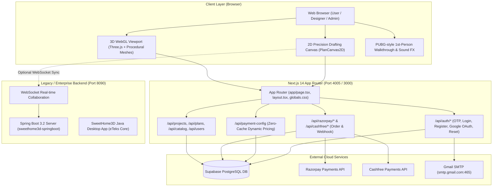

# DecoFrog 3D — Master Session Memory & Architecture Reference

> **Session Memory File**: This living document stores the comprehensive architecture, subsystem contracts, environment configurations, business guardrails, and cumulative session changes for **DecoFrog 3D** (SweetHome 3D Visual Studio). Every subsequent agent and developer must read and update this file before and after making coding changes.

---

## 1. Executive Summary & Live Deployments

| Property | Value | Notes |
| :--- | :--- | :--- |
| **Product Brand** | **DecoFrog 3D** | Formerly *SweetHome 3D Studio* / *Visual Rendered* |
| **Production Domain** | `https://decofrog3d.com` | Primary custom domain |
| **Secondary Domain** | `https://www.decofrog3d.com` | Automated CNAME/Cloudflare proxy |
| **Vercel Host** | `https://decofrog3d.vercel.app` | Vercel Serverless Production Deployment |
| **Vercel Project ID** | `prj_ZKbFVbu8318QxXF3yBzI9pYqu930` | Project Name: `decofrog3d` |
| **Vercel Team ID** | `team_4vKF1DEVQnMusUXWNnyzVMMB` | Account: `prigenixsoftware-a11ys-projects` / `prigenixsoftware@gmail.com` |
| **Git Repository** | `https://github.com/bharath185/sweet_home.git` | Branch: `master` |
| **Cloud Database** | Supabase Cloud PostgreSQL | `https://tviakpxdnomilnukbjtw.supabase.co` |
| **DNS / CDN** | Cloudflare | Nameservers: `chan.ns.cloudflare.com`, `clyde.ns.cloudflare.com` |
| **Active Currency** | INR (₹) | Default currency for all subscriptions |

---

## 2. High-Level Architecture Topology



---

## 3. Subsystem Breakdown

### 3.1 Frontend (`frontend-nextjs`)
- **Framework**: Next.js 14.2 (App Router) + React 18 + TypeScript 5.7.
- **Styling**: Tailwind CSS 3.4 + Ant Design (`antd` 6.6) + Lucide Icons + Canvas Confetti.
- **Core 3D Engine (`src/components/Viewport3D.tsx`)**:
  - Three.js WebGL rendering with `RoomEnvironment`, realistic shadows, and multi-light calculation.
  - **Procedural 3D Geometry (`src/services/proceduralFurniture.ts`)**: Generates custom parametric tables, chairs, sofas, cabinets, beds, lamps, shelves, doors, windows, stairs, TV units, radiators, sanitary items, appliances, botanical items on the fly without heavy remote asset downloads.
  - **Asset Loaders**: Custom OBJ loader (`src/services/objParser.ts`) and GLTF/GLB loader (`src/services/modelLoader.ts`).
  - **Interactive First-Person Walkthrough**: Dual-mode camera (`aerial` vs `visitor`), PUBG-style game HUD (`PubgGameHud.tsx`), audio effects for footsteps/doors (`soundEffects.ts`), proximity door opening.
  - **PBR Materials**: Configurable roughness, metalness, textures, wood, fabric, leather, marble (`pbrTextures.ts`).
- **Core 2D Drafting Engine (`src/components/PlanCanvas2D.tsx`)**:
  - Vector/canvas CAD drawing: wall extrusion, room boundary auto-calculation, doors, windows, stairs, dimensions, text notes.
  - Multi-floor drafting: Ground Floor (`level: 0`), First Floor (`level: 1`), with support for `single`, `sideBySide`, and `stacked` preview modes.
  - **Collision Detection (`src/services/collisionDetector.ts`)**: Real-time bounding polygon collision detection preventing furniture overlaps.
  - **Tabletop Auto-Attachment (`src/services/tabletopAttachment.ts`)**: Auto-elevates lamps, laptops, and decor onto table surfaces.
- **Dynamic Pricing Engine**:
  - Never caches prices in `localStorage` or `sessionStorage`.
  - Always fetches live tiers from `/api/payment-config` with instant loading skeletons.

### 3.2 Next.js API Layer (`src/app/api`)
- **Authentication Routes (`/api/auth/`)**:
  - `login`, `register`, `forgot-password`, `reset-password`, `send-otp`, `verify-otp`, `send-credentials`, `google`.
  - Generates 6-digit cryptographic OTPs with 10-minute expiry stored in Supabase / memory store.
  - Social Google login verified via `google-auth-library` restricted to `@gmail.com` and `@googlemail.com`.
- **Payment Routes**:
  - `/api/payment-config`: Serves live active payment gateway (`razorpay` or `cashfree`), currency (`INR`), and plan definitions with `no-store, no-cache` headers.
  - `/api/razorpay/create-order` & `/api/razorpay/verify-payment`: Initiates and validates Razorpay signatures.
  - `/api/cashfree/create-order`, `/api/cashfree/verify-payment`, `/api/cashfree/webhook`: Initiates and validates Cashfree PG orders and webhooks.
- **Data Routes**:
  - `/api/projects`: User-saved 2D/3D floorplans stored in Supabase `projects` table.
  - `/api/catalog/furniture`: Custom catalog item management.
  - `/api/admin/payments` & `/api/admin/payment-config`: Admin dashboard oversight for transactions and pricing adjustments.

### 3.3 Database Layer (Supabase Cloud)
- **URL**: `https://tviakpxdnomilnukbjtw.supabase.co`
- **Tables**:
  - `users`: User profiles, hashed passwords, roles (`ADMIN`, `DESIGNER`, `CUSTOMER`, `CLIENT`), subscription status, pass duration, order IDs.
  - `projects`: JSON plan payloads (`HomePlan` schema), thumbnail data URLs, user foreign keys.
  - `templates`: Architectural starter templates (e.g. Modern Villa, Penthouse, Studio).
  - `payment_transactions`: Audit log of order IDs, amounts, gateway names, payment status (`paid`, `pending`, `failed`).
  - `plans`: Dynamic pricing tier configurations.

### 3.4 Spring Boot Backend (`sweethome3d-springboot`)
- **Framework**: Spring Boot 3.2.5 + Java 17 + Spring Data JPA + PostgreSQL.
- **Port**: `8090`.
- **WebSocket Engine (`WebSocketConfig.java`)**: STOMP / SockJS broker for multi-designer collaborative editing.
- **SweetHome Core Bridge**: Headless Java interface to SweetHome3D models and SweetHome export pipelines.

---

## 4. Business Rules & Guardrails (Mandatory)

1. **Dynamic Pricing (Zero Stale Hardcoded Prices)**:
   - All subscription costs MUST be queried from `/api/payment-config` or Supabase.
   - Hardcoding subscription prices in components or saving them to browser `localStorage` is strictly forbidden.
   - **Current Live Plans**:
     - **24-Hour All-Access Pass**: ₹51 (Duration: Exactly 24 Hours / 1 Day, ID: `trial_2days`)
     - **Monthly Pro Pass**: ₹199 (Duration: 30 Days, ID: `monthly`)
     - **Annual Pro Pass**: ₹1,999 (Duration: 365 Days, ID: `yearly`)
2. **Pass Expiration Logic**:
   - The 24-hour pass expires exactly `now + 24 hours` (`durationDays: 1`).
   - Expired users must be gracefully prompted with `UpgradeModal` or `SubscriptionPaywall`.
3. **Brand Identity**:
   - Official Brand Name: **DecoFrog 3D**.
   - Notifications & Emails Sender: `"DecoFrog 3D" <contact@prigenix.com>`.
   - Links sent in emails must resolve to `https://decofrog3d.com` (never `localhost:3000` in production).
4. **Authentication Constraints**:
   - Google OAuth is strictly restricted to `@gmail.com` and `@googlemail.com`.
   - Non-Gmail users must authenticate via email OTP.
5. **Multi-Floor Elevation Rules**:
   - Ground floor: `elevation: 0`, `height: 250cm`.
   - 1st floor: `elevation: 250cm`, `height: 250cm`.
   - Furniture items must carry `floorLevel: 0 | 1` to render at the correct vertical elevation.

---

## 5. Environment Variables Schema

The production environment on Vercel contains 20 environment variables. All variables are documented in `frontend-nextjs/.env.example`:

| Environment Variable | Description / Sample Value |
| :--- | :--- |
| `NEXT_PUBLIC_SUPABASE_URL` | `https://tviakpxdnomilnukbjtw.supabase.co` |
| `NEXT_PUBLIC_SUPABASE_ANON_KEY` | Supabase Anonymous Client Key |
| `SUPABASE_SERVICE_ROLE_KEY` | Supabase Admin Service Role Secret Key |
| `NEXT_PUBLIC_PAYMENT_GATEWAY` | Active Gateway (`razorpay` or `cashfree`) |
| `NEXT_PUBLIC_APP_CURRENCY` | `INR` |
| `NEXT_PUBLIC_RAZORPAY_KEY_ID` | Razorpay Key ID |
| `RAZORPAY_KEY_SECRET` | Razorpay Secret Key |
| `NEXT_PUBLIC_CASHFREE_APP_ID` | Cashfree App ID |
| `CASHFREE_APP_ID` | Cashfree Backend App ID |
| `CASHFREE_SECRET_KEY` | Cashfree Secret Key |
| `CASHFREE_ENVIRONMENT` | `PRODUCTION` or `SANDBOX` |
| `SUBSCRIPTION_JWT_SECRET` | JWT Signing Secret for user subscription tokens |
| `NEXT_PUBLIC_GOOGLE_CLIENT_ID` | Google OAuth 2.0 Client ID |
| `GOOGLE_CLIENT_SECRET` | Google OAuth 2.0 Secret |
| `SMTP_HOST` | `smtp.gmail.com` |
| `SMTP_PORT` | `465` |
| `SMTP_USER` | `contact@prigenix.com` |
| `SMTP_PASS` | Gmail App Password (16 characters) |
| `SMTP_FROM` | `"DecoFrog 3D" <contact@prigenix.com>` |
| `NEXT_PUBLIC_APP_URL` | `https://decofrog3d.com` |

---

## 6. Directory Structure & Key Files

```
sweet_home/
├── .agents/
│   └── rules/
│       └── project_context.md          # Antigravity Workspace Rules
├── AGENTS.md                           # Antigravity Pair-Programming Guidelines
├── GEMINI.md                           # Master Architecture & Deployment Blueprint
├── SESSION_MEMORY.md                   # THIS FILE: Master Living Session Memory
├── docs/                               # Feature specifications & PDF guides
├── frontend-nextjs/                    # Production Next.js 14 App
│   ├── .env.example                    # Template for environment variables
│   ├── package.json                    # Dependencies (Next 14, Three.js, Ant Design)
│   ├── src/
│   │   ├── app/
│   │   │   ├── page.tsx                # Studio main page (2D/3D split, ribbons, modals)
│   │   │   ├── layout.tsx              # Root HTML wrapper with AntdRegistry
│   │   │   └── api/                    # Serverless API routes (auth, payments, plans)
│   │   ├── components/                 # Viewport3D, PlanCanvas2D, Modals, Navbars
│   │   ├── services/                   # Procedural furniture, collision, loaders, audio
│   │   ├── lib/                        # Supabase clients, payment stores, OTP service
│   │   └── types/                      # HomePlan, FurnitureItem, Wall, User interfaces
├── sweethome3d-springboot/             # Java 17 Spring Boot Backend (Port 8090)
│   ├── pom.xml                         # Spring Boot 3.2 dependencies
│   └── src/main/java/com/eteks/        # Controllers, Repositories, Entities, WebSockets
├── web-app-react/                      # Standalone Vite React 18 client
├── SweetHome3D/                        # eTeks Java Desktop Source
└── SweetHome3DJS/                      # SweetHome3D JS Canvas / CheerpJ build
```

---

## 7. Known Quirks, Traps & Guidelines

- **Port Conflict**: `frontend-nextjs` dev script uses `-p 4005` locally to avoid colliding with other apps on `3000`. In production (Vercel), it binds to standard web ports.
- **Batch Scripts Paths**: `start-full-web-app.bat` has older hardcoded paths referencing `d:\PROJECTS\sweethome\`. When running batch scripts locally on Windows, always ensure paths match `c:\Users\vanda\OneDrive\Desktop\project_parik\sweethome3d\sweet_home` or use relative `%~dp0`.
- **Three.js Context Loss Prevention**: When unmounting or switching between floors, `safelyDisposeRenderer` in `webglHelper.ts` must be used to release WebGL contexts and avoid memory leaks.
- **Dynamic Plan Loading**: When creating or editing modals that display pricing (e.g. `UpgradeModal.tsx`, `SubscriptionPaywall.tsx`), never write static price tags like `₹51` or `₹199` directly in the markup. Always consume `usePaymentConfig` or the plan state returned from `/api/payment-config`.

---

## 8. Local VS Code Developer Requirements & Prerequisites

### Tier 1: Core Web Studio (`frontend-nextjs`) - Mandatory
1. **Node.js**: v18.x, v20.x, or v22.x LTS (Bundles `npm` v10+).
2. **Visual Studio Code**:
   - Extension: **Tailwind CSS IntelliSense** (`bradlc.vscode-tailwindcss`)
   - Extension: **ESLint** (`dbaeumer.vscode-eslint`)
   - Extension: **Prettier - Code formatter** (`esbenp.prettier-vscode`)
3. **Environment**: `frontend-nextjs/.env.local` created from `frontend-nextjs/.env.example`.
4. **Browser**: Chrome / Edge / Firefox with hardware acceleration enabled for WebGL 2.0.

### Tier 2: Java Spring Boot Backend (`sweethome3d-springboot`) - Optional
1. **Java Development Kit (JDK)**: JDK 17 (e.g., Eclipse Temurin 17 or Oracle OpenJDK 17).
2. **Build Tool**: Apache Maven 3.8+ (for `pom.xml`).
3. **Database**: PostgreSQL 14+ (Local port 5432, database: `decofrog_db` or `sweethome_db`).
4. **VS Code Extensions**:
   - Extension Pack for Java (`vscjava.vscode-java-pack`)
   - Spring Boot Extension Pack (`vmware.vscode-spring-boot`)

---

## 9. Session History & Ongoing Changes

| Commit / Date | Scope | Description |
| :--- | :--- | :--- |
| `bbe7534` | Branding & Links | Rebranded to DecoFrog 3D, fixed credentials portal link, busted pricing plan cache. |
| `9ebf3e0` | Auth & SMTP | Real Forgot Password with Gmail SMTP OTP dispatch & password reset. |
| `3d551aa` | Pricing Architecture| Eradicated local storage caching and static fallback prices; 100% dynamic prices loaded from DB with skeleton loaders. |
| `2a4176e` | Subscriptions | Changed trial & access pass duration strictly to 24 Hours (1 Day) at ₹51. |
| `7fe59b3` | Documentation | Added Antigravity handover guide, workspace rules, and environment template. |
| **Session Start** | **Architecture & Session Memory** | Analyzed entire project tree (Next.js, Spring Boot, Java core, DB, APIs) and established living master `SESSION_MEMORY.md` and conversation artifact. |
| **Dev Server Online** | **Runtime Initialization** | Installed dependencies (`npm install`), initialized `frontend-nextjs/.env.local`, and launched Next.js dev server on `http://localhost:4005`. Verified `/` and `/api/payment-config` return HTTP 200. |
| **VS Code Setup Complete** | **Developer Experience** | Installed VS Code extensions (`bradlc.vscode-tailwindcss`, `esbenp.prettier-vscode`, `dbaeumer.vscode-eslint`). Created root `package.json`, `.vscode/tasks.json`, `start.bat`, and portable batch/PowerShell launch scripts with auto-browser launch. |
| **Login Fit & Brand Logo** | **UI/UX & Branding** | 1) Fixed login page template sizing: balanced 3D simulator (`h-[300px] sm:h-[380px] lg:h-[500px]`), compact responsive container (`max-w-6xl`, `py-6`), mobile-first ordering (`order-1` for auth card on mobile), and streamlined card padding (`p-5 sm:p-6`) so the entire template fits on standard screens without overflow. 2) Replaced text branding with the official DecoFrog 3D Space Planner logo across `LoginPage`, `Navbar`, `SweetHomeRibbon`, `SubscriptionPaywall`, `ProjectManagerModal`, `page.tsx` loaders, and `app.ts`. |
| **Luxury Logo Styling** | **UI/UX Polish** | Styled the logo across all touchpoints to match the application's luxury theme: golden ambient halos (`from-amber-500/25 via-sky-500/20 to-indigo-500/25`), delicate metallic amber rim rings (`ring-amber-400/35`), ivory-to-amber frosted plinths, and subtle drop shadows that harmonize with the dark slate glassmorphism palette. |

---

> **Instruction for Future Coding Turns**: Before making any code modifications, verify requirements against Section 4 (Business Rules). Upon completing code modifications, append a concise log to Section 8 above.
